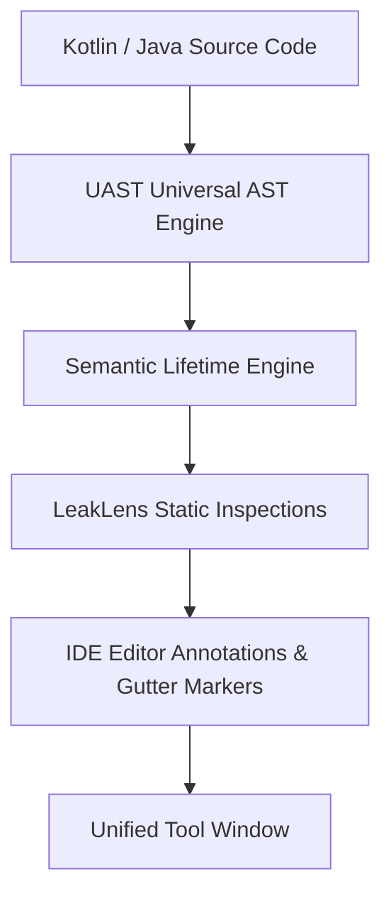
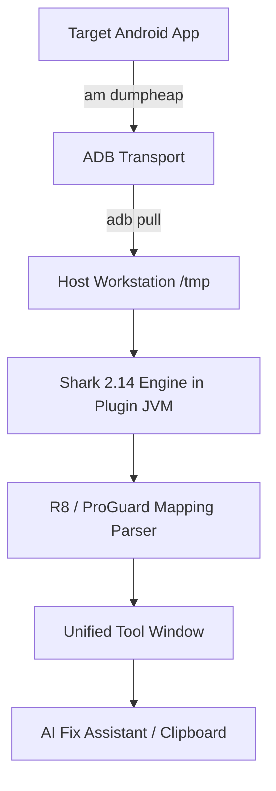

# LeakLens 🧠💧

[](https://plugins.jetbrains.com/plugin/32079-leaklens--android-memory-leak-detector--ai-fix-assistant)
[](https://github.com/dev-vikas-soni/leak-lens)
[](LICENSE)

**LeakLens** is an Android memory analysis and debugging plugin for Android Studio and IntelliJ IDEA. It combines lifecycle-aware UAST static inspections with host-side heap analysis powered by Shark. It enables developers to inspect code patterns during authoring and analyze runtime heap dumps captured over ADB without requiring a LeakLens runtime SDK in the target application.

---

## Technical Positioning

Standard Android memory analysis often requires choosing between runtime APK overhead (e.g. including in-app heap analyzers in debug builds) or manual heap capture and inspection inside profilers.

LeakLens bridges this gap through a two-pillar design:

1. **Author-Time Static Analysis**: Analyzes Kotlin and Java code in the IDE using UAST and a **Semantic Lifetime Engine** to catch memory retention hazards while writing code.
2. **Host-Side Heap Analysis (Zero-SDK)**: Triggers heap dumps via ADB (`am dumpheap`), transfers the `.hprof` file to the host workstation, and executes graph reachability analysis using **Shark** in the plugin JVM—offloading memory processing entirely from the target device.

---

## Core Capabilities

- 🔍 **Lifecycle-Aware Static Inspections**: Identifies dangerous retention patterns across Jetpack Compose, Coroutines, Flow, Hilt/Dagger, ViewModels, Workers, and classic Android components.
- ⚡ **Zero-SDK Heap Analysis**: Analyzes production or debug APK heap dumps on the host machine without adding any runtime dependencies, tracking code, or SDK bloat to your application.
- 📊 **Periodic Memory Monitoring**: Monitors device heap stats periodically (approx. 5-second intervals via `adb shell dumpsys meminfo`) and optionally triggers automated heap dumps when user-configured thresholds are exceeded.
- 🤖 **AI-Assisted Remediation**: Generates contextual fix recommendations using OpenAI (`gpt-4o-mini`) or Google Gemini (`gemini-flash-latest`), or exports formatted analysis prompts to the system clipboard for use with IDE AI tools.
- 🗺️ **ProGuard / R8 Deobfuscation**: Parses `mapping.txt` build artifacts to deobfuscate class, method, and field names in heap reference chains.
- 📌 **Unified Issue Tool Window**: Consolidates static analysis findings and runtime heap traces into a single workspace panel with baseline support for issue deduplication.

---

## Architecture Overview

LeakLens operates across two distinct environments: the **Android Device** (running the target app) and the **IDE Host** (running the plugin, UAST engine, and Shark).

### 1. Static Analysis Workflow



### 2. Host-Side Heap Analysis Workflow



---

## Semantic Lifetime Engine

The **Lifetime Engine** evaluates potential memory leaks by assigning a priority to object and scope lifecycles. A retention risk is flagged when an owner with a higher priority (longer lifetime) retains a reference to an object with a lower priority (shorter lifetime).

| Lifetime Scope | Priority | Examples / Triggers |
|:---|:---:|:---|
| **PROCESS** | 100 | Process execution scope, `GlobalScope`, static variables |
| **APPLICATION** | 90 | `android.app.Application` |
| **SINGLETON** | 80 | `@Singleton` (Hilt/Dagger), static `INSTANCE` objects |
| **WORKER** | 70 | `androidx.work.ListenableWorker` |
| **SERVICE** | 60 | `android.app.Service` |
| **VIEWMODEL** | 50 | `androidx.lifecycle.ViewModel` |
| **ACTIVITY** | 40 | `android.app.Activity`, `ComponentActivity` |
| **FRAGMENT** | 30 | `androidx.fragment.app.Fragment` |
| **COMPOSITION** | 25 | Compose `remember { ... }` blocks, `produceState` |
| **VIEW** | 20 | `android.view.View`, `Drawable` |
| **LOCAL** | 10 | Method parameters, local variables |

### Priority Rule Example
If a class with `@Singleton` scope (Priority 80) holds a field reference to an `Activity` (Priority 40), the Lifetime Engine flags a **HIGH** confidence lifetime mismatch:
$$\text{Priority}(\text{SINGLETON}) > \text{Priority}(\text{ACTIVITY}) \implies \text{Retention Hazard}$$

---

## AI Privacy & Data Transmission

LeakLens supports opt-in AI assistance for analyzing leak traces and generating fixes:

- **Disabled by Default**: No network connections or AI requests occur unless AI analysis is explicitly enabled in settings or requested via clipboard actions.
- **Transmitted Data**: When direct API calls are triggered, LeakLens transmits the leaking class name, retained byte size, reference chain (class names, field names, reference types), and full stack trace to the selected provider (OpenAI or Google Gemini).
- **Best-Effort Anonymization**: An optional package anonymization setting replaces common package prefixes (e.g. `com.example.app` $\rightarrow$ `app.pkg`). Note that regex-based sanitization is best-effort and does not guarantee absolute package or identifier anonymization.
- **Clipboard Workflow**: Selecting "Ask Gemini" formats a prompt with trace details and copies it to the system clipboard, allowing developers to paste context into IDE chat windows manually without direct API key sharing.

---

## Feature Matrix & Known Limitations

| Capability | Scope & Mechanism | Limitation / Note |
|:---|:---|:---|
| **Static Inspections** | UAST-based static code analysis | Heuristic rules; relative lifetime analysis does not guarantee discovery of all runtime state leaks. |
| **Heap Analysis** | Shark 2.14 on IDE JVM via ADB | Memory warning triggers if `fileSize > maxMemory * 0.8` to notify of heavy memory usage. |
| **Memory Monitoring** | `dumpsys meminfo` via ADB | Periodic polling (approx. 5-second intervals), not instantaneous streaming. |
| **Deobfuscation** | R8 / ProGuard `mapping.txt` parser | Maps class, method, and field names; line-number remapping is currently unsupported. |
| **Golden Verification** | Deterministic HPROF fixture suite | Regression suite under active investigation; fixtures do not currently pass out-of-the-box. |

---

## Feature Comparison

| Dimension | LeakLens | Android Profiler | LeakCanary |
|:---|:---|:---|:---|
| **Feedback Timing** | Authoring (Static) + Debug (Heap) | Debug / Profiling Session | Runtime Execution |
| **APK Footprint** | **Zero SDK** | Zero SDK | ~300 KB debug dependency |
| **Analysis Location** | Host Workstation JVM | Host Workstation | On-Device JVM |
| **Lifetime Awareness** | UAST Semantic Lifetime Engine | None | None |
| **Remediation Support** | IDE Intentions + Opt-In AI | Manual | Stack trace output |

---

## Installation & Getting Started

### Installation
1. Open **Android Studio** or **IntelliJ IDEA**.
2. Go to **Settings/Preferences** $\rightarrow$ **Plugins** $\rightarrow$ **Marketplace**.
3. Search for **LeakLens** and click **Install**.

### Quick Start Workflow
1. **Static Analysis**: Open any Kotlin or Java Android project. Leaky code patterns (such as passing an Activity context to a Singleton or capturing Context in `remember`) are highlighted automatically in the editor.
2. **Device Connection**: Connect an Android device or emulator with USB debugging enabled.
3. **Capture Heap Dump**: Open the **LeakLens** tool window at the bottom of the IDE and click **Dump Heap Now**.
4. **View Reference Chains**: Inspect the analyzed leak trace, retained size, and reference chain in the Unified Issue Tool Window.

---

## Verification & Testing

LeakLens includes an automated fixture-based regression suite in the `:verification` subproject:

```bash
# Run verification runner across golden HPROF fixtures
./gradlew :verification:verify
```

> **Note on Verification Status**: The verification framework tests Shark parsing against stored `.hprof` fixtures. Scenarios are currently under active maintenance to align expected JSON outputs with updated Shark inspectors.

---

## Technical Session & DroidCon India 2026

LeakLens and its underlying host-side memory analysis architecture will be presented at **DroidCon India 2026**:

- **Session**: *"Beyond Leak Detection: Building an End-to-End Memory Debugging Workflow Inside Android Studio"*
- **Speaker**: Vikas Soni ([Speaker Profile](https://india.droidcon.com/droidcon-2026-speakers/vikas-soni))

---

## Contributing

Contributions are welcome! Please review [CONTRIBUTING.md](CONTRIBUTING.md) and our [Code of Conduct](CODE_OF_CONDUCT.md) before submitting pull requests.

## License

LeakLens is released under the [Apache 2.0 License](LICENSE).
