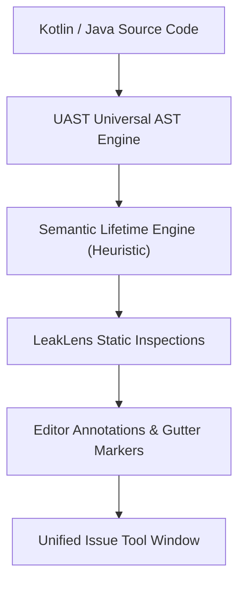
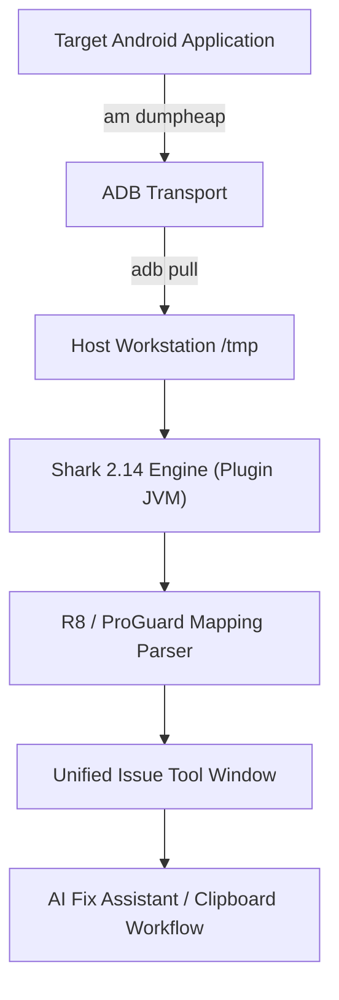

# LeakLens 🧠💧

[](https://plugins.jetbrains.com/plugin/32079-leaklens--android-memory-leak-detector--ai-fix-assistant)
[](https://github.com/dev-vikas-soni/leak-lens)
[](LICENSE)

**LeakLens** is an Android memory analysis and debugging plugin for Android Studio and IntelliJ IDEA. It combines lifecycle-aware UAST static inspections with host-side heap analysis powered by Shark. It enables developers to inspect code patterns during authoring and analyze runtime heap dumps captured over ADB without requiring a LeakLens runtime SDK in the target application.

---

## Technical Positioning

Android memory debugging tools address different stages of the development lifecycle:

- **Android Profiler**: Built into Android Studio for real-time memory graphing, live allocation tracking, and native memory profiling.
- **LeakCanary**: Runs on-device as a debug dependency to detect and report memory leaks automatically during runtime app testing.
- **LeakLens**: Focuses on **author-time static analysis** (catching structural retention hazards while typing) and **zero-SDK host-side heap analysis** (offloading Shark graph traversal from the target device to the host workstation JVM via ADB).

LeakLens is designed to complement existing tools rather than replace them.

---

## Core Capabilities

- 🔍 **Lifecycle-Aware Static Inspections**: Identifies structural memory retention hazards across Jetpack Compose, Coroutines, Flow, Hilt/Dagger, ViewModels, Workers, and classic Android components.
- ⚡ **Zero-SDK Host-Side Heap Analysis**: Captures HPROF dumps via ADB (`am dumpheap`) and analyzes object reachability using **Shark 2.14** on the host workstation JVM—adding zero runtime SDK code or dependencies to your application.
- 📊 **Periodic Memory Monitoring**: Periodically polls device heap statistics (approx. 5-second intervals via `adb shell dumpsys meminfo`) and optionally triggers automated heap dumps when user-configured thresholds are exceeded.
- 🤖 **AI-Assisted Remediation**: Offers direct API integrations (OpenAI `gpt-4o-mini` or Google Gemini `gemini-flash-latest`) and a local clipboard prompt generation workflow for use with IDE AI assistants.
- 🗺️ **ProGuard / R8 Deobfuscation**: Parses `mapping.txt` build artifacts to deobfuscate class, method, and field names in heap reference chains (line-number remapping is unsupported).
- 📌 **Unified Issue Tool Window**: Consolidates static analysis findings and runtime heap traces into a single workspace panel with baseline support for issue deduplication.

---

## Architecture Overview

LeakLens separates static code inspection from host-side heap parsing:

### 1. Static Analysis Workflow



### 2. Host-Side Heap Analysis Workflow



---

## Semantic Lifetime Engine

The **Lifetime Engine** provides a static-analysis heuristic for evaluating potential memory retention hazards. It assigns relative priorities to object and scope lifecycles based on expected duration in an Android process:

| Lifetime Scope | Priority | Description / Examples |
|:---|:---:|:---|
| **PROCESS** | 100 | Process execution scope, `GlobalScope`, static variables |
| **APPLICATION** | 90 | `android.app.Application` instance |
| **SINGLETON** | 80 | `@Singleton` (Hilt/Dagger), static `INSTANCE` objects |
| **WORKER** | 70 | `androidx.work.ListenableWorker` |
| **SERVICE** | 60 | `android.app.Service` |
| **VIEWMODEL** | 50 | `androidx.lifecycle.ViewModel` |
| `ACTIVITY` | 40 | `android.app.Activity`, `ComponentActivity` |
| `FRAGMENT` | 30 | `androidx.fragment.app.Fragment` |
| **COMPOSITION** | 25 | Compose `@Composable` scope, `remember { ... }` blocks |
| **VIEW** | 20 | `android.view.View`, `Drawable` |
| **LOCAL** | 10 | Method parameters, local variables |

### Heuristic Priority Rule (Illustrative Example)
If a class with `@Singleton` scope (Priority 80) holds a field reference to an `Activity` (Priority 40), the Lifetime Engine flags a **HIGH** confidence lifetime mismatch:
$$\text{Priority}(\text{SINGLETON}) > \text{Priority}(\text{ACTIVITY}) \implies \text{Structural Retention Hazard}$$

> **Note on Static Heuristics**: Lifetime mismatches represent structural code hazards identified during static analysis. Storing an object of lower priority does not constitute definitive proof of an active runtime memory leak, as references may be cleared dynamically at runtime.

### Compose Inspection Behavior
Static analysis in LeakLens evaluates Jetpack Compose code specifically for cross-scope transfers:
- **Safe**: Capturing `Context` or `Activity` in a `remember { ... }` block is treated as safe by static inspections, because an `Activity` outlives the `Composition` (`ACTIVITY` priority 40 > `COMPOSITION` priority 25).
- **Flagged**: Passing a UI `Context` or `Activity` from Compose into a longer-lived component (such as a `ViewModel`, `ViewModelProvider.Factory`, or `@Singleton`) is flagged as a structural hazard.

---

## AI Privacy & Workflows

LeakLens provides two distinct AI remediation workflows:

1. **Local Clipboard Workflow (`askGemini`)**: Formats a markdown prompt containing the leak summary and trace details, copying it directly to the system clipboard. This mode operates **entirely locally** and makes **no network requests**.
2. **Direct API Mode (Opt-In)**: When explicitly enabled in settings with a user-provided API key, LeakLens calls external endpoints (OpenAI `gpt-4o-mini` or Google Gemini `gemini-flash-latest`). Transmitted metadata includes leaking class names, retained byte sizes, reference chain field/class names, and stack traces. **Source files (`.kt` / `.java`) are never sent.**

### Anonymization & Data Disclosure
- An optional package anonymization setting applies regex replacements (`com.\w+.\w+` $\rightarrow$ `app.pkg`).
- **Best-Effort Anonymization**: Regex sanitization is best-effort and does not guarantee complete anonymization or zero data exposure. Custom identifiers or parameter strings may still be visible in transmitted prompts.

---

## Technical Limitations & Verification Status

- **Memory Warning Threshold**: In `LeakAnalysisCoordinator.kt`, if an HPROF file size exceeds 80% of host JVM max memory (`fileSize > maxMemory * 0.8`), LeakLens displays a UI warning notification to alert the user of high host memory usage. This warning does not forcibly abort analysis.
- **Monitoring Polling**: Device memory monitoring periodically queries `dumpsys meminfo` (approx. 5-second intervals); it is not instantaneous streaming.
- **Golden Verification**: The `:verification` subproject provides a deterministic regression framework testing Shark parsing against stored `.hprof` fixtures. Scenarios are currently under active maintenance to align expected JSON schemas with updated Shark inspectors; the suite does not currently pass out-of-the-box.
- **Performance Figures**: Benchmarks listed in [PERFORMANCE.md](docs/PERFORMANCE.md) reflect historical internal measurements on Apple M2 Pro hardware and are provided for baseline context rather than performance guarantees.

---

## Tool Comparison

| Dimension | LeakLens | Android Profiler | LeakCanary |
|:---|:---|:---|:---|
| **Primary Use Case** | Author-time static inspections + Host-side heap dumps | Live memory graphs & allocation tracking | Automated in-app leak detection during testing |
| **APK Footprint** | **Zero SDK** (Host-side via ADB) | Zero SDK (Built-in IDE profiler) | Debug build dependency |
| **Analysis Location** | Host Workstation JVM (Shark 2.14) | Host Workstation IDE | Target Device JVM |
| **Lifetime Analysis** | UAST Static Heuristic Engine | None | None (Runtime reachability) |
| **Remediation Workflow** | Quick-fixes + Clipboard / Opt-in AI | Manual investigation | Stack trace output |

---

## Installation & Getting Started

### Installation
1. Open **Android Studio** or **IntelliJ IDEA**.
2. Go to **Settings/Preferences** $\rightarrow$ **Plugins** $\rightarrow$ **Marketplace**.
3. Search for **LeakLens** and click **Install**.

### Quick Start Workflow
1. **Static Analysis**: Open any Kotlin or Java Android project. Code patterns violating lifetime rules (such as passing an Activity context to a ViewModel or Singleton) are highlighted automatically in the editor.
2. **Device Connection**: Connect an Android device or emulator with USB debugging enabled.
3. **Capture Heap Dump**: Open the **LeakLens** tool window at the bottom of the IDE and click **Dump Heap Now**.
4. **View Reference Chains**: Inspect the analyzed leak trace, retained size, and reference chain in the Unified Issue Tool Window.

---

## Verification & Testing

Execute the verification runner across golden HPROF fixtures:

```bash
./gradlew :verification:verify
```

---

## Technical Session & DroidCon India 2026

LeakLens and its underlying host-side memory analysis architecture will be presented at **DroidCon India 2026**:

- **Session**: *"Beyond Leak Detection: Building an End-to-End Memory Debugging Workflow Inside Android Studio"*
- **Speaker**: Vikas Soni ([Speaker Profile](https://india.droidcon.com/droidcon-2026-speakers/vikas-soni))

---

## Contributing & License

- **Contributing**: Review [CONTRIBUTING.md](CONTRIBUTING.md) and [CODE_OF_CONDUCT.md](CODE_OF_CONDUCT.md).
- **License**: Released under the [Apache 2.0 License](LICENSE).
