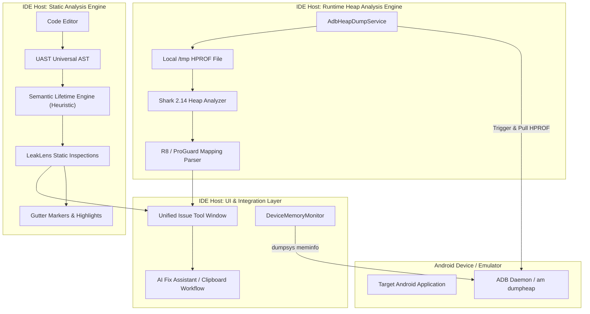

# LeakLens Architecture Specification

LeakLens is an IntelliJ Platform plugin for Android memory analysis. It combines author-time UAST static code inspections with host-side Shark heap dump analysis.

---

## 1. System Architecture

The plugin is structured around two execution pipelines: **Static Analysis** (local UAST inspections in the IDE) and **Heap Analysis** (offloaded Shark graph analysis via ADB).



---

## 2. Execution Pipelines

### Static Code Analysis Pipeline
1. **Trigger**: Code editing, file saving, or manual inspection runs.
2. **UAST Parsing**: IntelliJ UAST engine converts Kotlin/Java source code into unified AST structures.
3. **Lifetime Engine Heuristics**: `LifetimeEngine` evaluates object/scope types, annotations (`@Singleton`, Hilt scopes), Compose constructs, and Coroutine scopes (`GlobalScope`, `viewModelScope`).
4. **Priority Check**: Compares `Owner.priority` vs `Referenced.priority`. If `Owner.priority > Referenced.priority`, a potential structural hazard is identified.
   - *Compose Handling*: `remember { context }` is treated as safe because `ACTIVITY` (40) > `COMPOSITION` (25). Passing UI `Context` to a `ViewModel` or `@Singleton` is flagged.
5. **Reporting**: Results are routed to editor highlights, gutter markers, and the Unified Issue Tool Window.

### Host-Side Heap Analysis Pipeline
1. **Trigger**: Developer clicks **Dump Heap Now** or `DeviceMemoryMonitor` triggers an automated capture.
2. **ADB Capture**: `AdbHeapDumpService` issues `am dumpheap <packageName> <remotePath>` over ADB.
3. **File Pull**: Pulls the HPROF file to the host OS `/tmp` directory and cleans up the remote device file.
4. **Memory Warning Check**: In `LeakAnalysisCoordinator.kt`:
   ```kotlin
   if (fileSize > maxMemory * 0.8) {
       // Emits a UI warning notification to alert user of potential high host JVM memory usage
   }
   ```
   *Note: This threshold produces an informational warning notification; it does not forcibly abort analysis.*
5. **Shark Graph Traversal**: `SharkAnalysisService` executes `HeapAnalyzer` on the host JVM thread pool.
6. **Deobfuscation**: `DeobfuscationService` applies loaded ProGuard/R8 mappings (`mapping.txt`) to deobfuscate class, field, and method symbols.
7. **Cleanup**: Temporary local HPROF files are deleted upon completion to avoid disk bloat.

---

## 3. Core Components Reference

| Service / Class | Responsibility | Execution Thread |
|:---|:---|:---|
| `LifetimeEngine` | Models relative object/scope lifetimes and priority heuristics | IDE ReadAction thread |
| `AdbHeapDumpService` | Handles ADB command execution, device listing, and HPROF file transfer | Background Thread |
| `SharkAnalysisService` | Executes Shark 2.14 graph reachability and leaking object search | `Task.Backgroundable` |
| `LeakAnalysisCoordinator` | Coordinates ADB capture, memory warning check, Shark analysis, and UI reporting | Pooled Background Thread |
| `DeviceMemoryMonitor` | Periodically polls `dumpsys meminfo` (approx. 5s interval) and checks threshold | Coroutine Scope |
| `DeobfuscationService` | Parses ProGuard `mapping.txt` and remaps symbols in leak traces | Background Thread |
| `AiAnalysisService` | Prepares prompts, applies regex anonymization, and calls external AI APIs | Background Thread |
| `AiUtils` | Formats local clipboard prompts for IDE AI tools (no network requests) | EDT / UI Thread |

---

## 4. Concurrency & Host Offloading Model

- **IDE Responsiveness**: Long-running Shark heap analysis operations run inside `Task.Backgroundable` background tasks to keep the Event Dispatch Thread (EDT) responsive.
- **Host Resource Offloading**: Graph traversal uses the host workstation JVM memory rather than executing analysis inside the target Android application.
- **Non-Blocking UAST Actions**: Code inspections use `ReadAction.nonBlocking` for type hierarchy queries.
